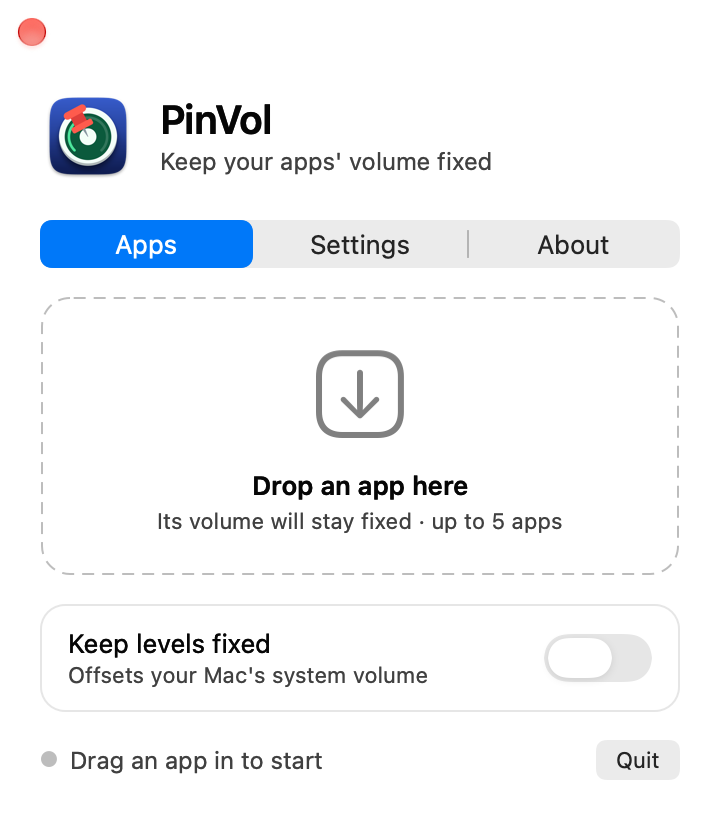
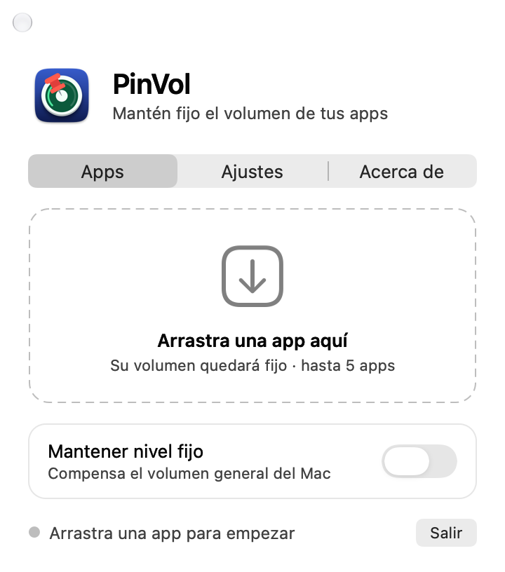
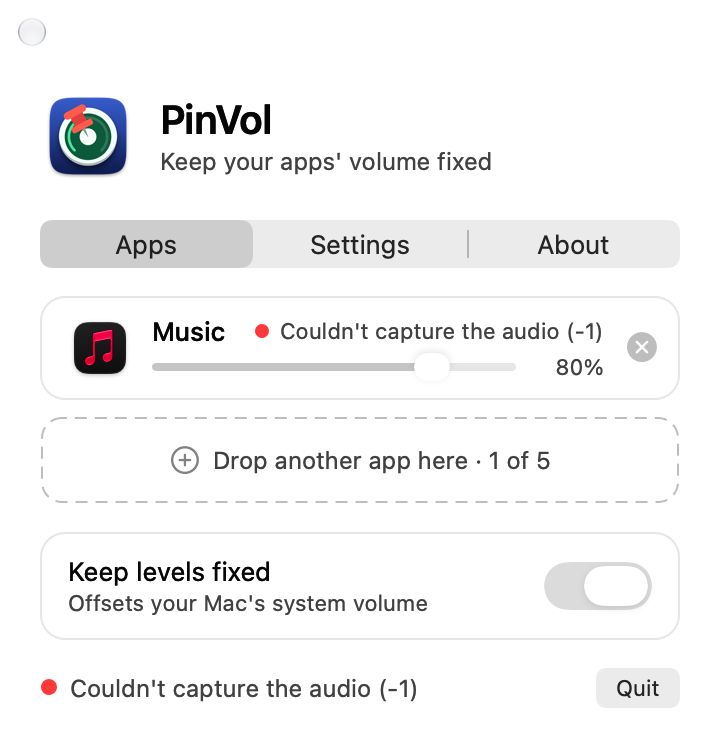
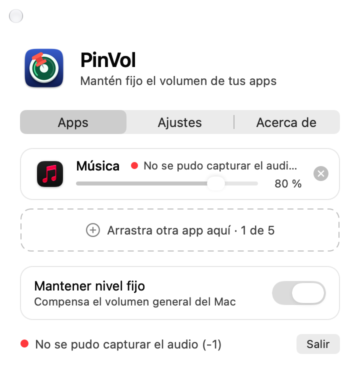
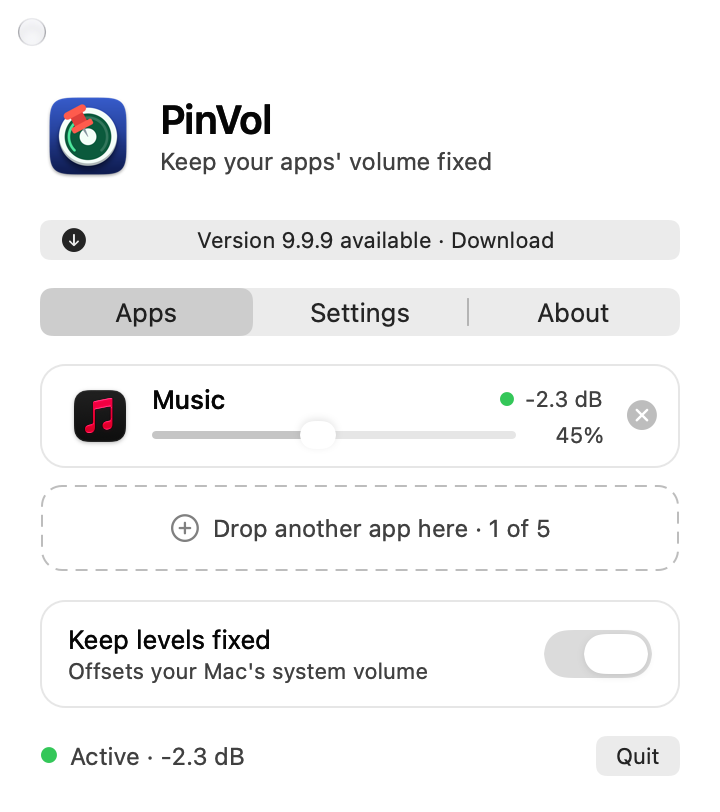
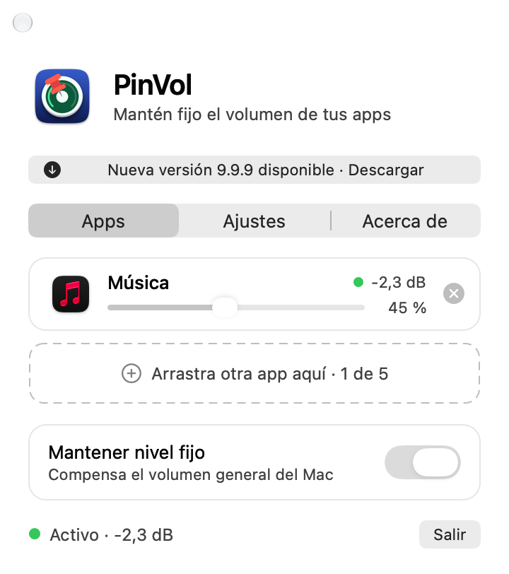

# PinVol — Auditoría de accesibilidad y UX

> **English summary.** Audit of PinVol 1.9 (`7fd184c`) against WCAG 2.2 AA and the macOS HIG. The app looks and feels right with a mouse, but it does not meet WCAG 2.2 AA: 50 findings (4 blocking, 15 high, 22 medium, 9 low). The core task — adding an app and setting its level — cannot be completed with a keyboard alone or with VoiceOver, and several hand-drawn elements fail the 3:1 non-text contrast threshold (measured: remove button 1.88:1, drop border 1.88:1, status dots 2.22–2.31:1). This document lists the evidence and the remediation plan; it is a working document in Spanish, not mirrored in English.
>
> **Estado.** Este documento describe el estado auditado en `7fd184c`. Las correcciones están en la rama `audit/accesibilidad-ux`; las comprobaciones automáticas que las cubren son `tools/test-a11y.sh`.

> **Alcance.** Código de la interfaz, textos, recursos y documentación. Fuera de alcance: motor de audio, instalador, cadena de release y README (solo su reflejo en la UI).
> **Base:** `main` en `7fd184c`, versión 1.9. **Fecha:** 18 de octubre de 2026.
> **Método:** lectura completa de los 12 archivos Swift (~2.350 líneas), `Info.plist`, las 99 cadenas y los flujos de CI; compilación real en macOS 27.0.1 (target macOS 26) con la variante `-DSNAPSHOT`; capturas propias de estados que los mockups no cubren; contraste medido píxel a píxel sobre PNG 2x.

## Veredicto

La app está bien construida en lo visual y usa controles nativos, pero está diseñada para ratón y vista normal. Con teclado, VoiceOver o baja visión, la tarea central se bloquea o se degrada:

- **No hay forma de añadir una app sin arrastrar.** No existe `NSOpenPanel`, ni botón, ni ítem de menú. Un usuario de teclado, VoiceOver o Switch Control no puede empezar.
- **Ningún mensaje se anuncia.** Los errores viven 3 s en el pie, la nota de la barra de menús 4 s, y no hay una sola llamada a `NSAccessibility.post(.announcementRequested)`. VoiceOver no se enterá de que algo falló.
- **El remedio del error de permiso solo existe en un tooltip.** El texto visible es "Couldn't capture the audio (-1)"; la instrucción de abrir Ajustes del Sistema → Grabación de audio está en `detail`, que solo aparece al pasar el ratón.
- **Los elementos dibujados a mano no llegan a 3:1.** El `×` para quitar (1,88:1), el borde discontinuo de la zona de arrastre (1,88:1, y es la única afordancia de la acción principal) y los puntos de estado (2,22:1 verde, 2,31:1 naranja).
- **La ventana no se puede redimensionar y todo el texto es de 11–13 pt fijos.** Con texto grande, las filas y los nombres se recortan sin salida.

Lo que sí está bien: el contraste del texto (10,37:1 claro / 9,25:1 oscuro), el respeto a Reduce Motion, la localización EN/ES completa y verificada por CI, controles nativos coherentes y cero dependencias.

## Conformidad WCAG 2.2 AA

| Criterio | Nivel | Estado | Evidencia |
|---|---|---|---|
| 1.1.1 Non-text Content | A | No cumple | Iconos sin descripción ni marcados decorativos (`Style.swift:19-22`) |
| 1.3.1 Info and Relationships | A | Parcial | La fila no es un grupo AX (`AppsPanel.swift:86-158`) |
| 1.4.1 Use of Color | A | Parcial | Estado "activo" solo con punto de 7 pt (`AppsPanel.swift:174-182`) |
| 1.4.3 Contrast (Minimum) | AA | Parcial | Pestaña seleccionada 4,15:1 (`SettingsWindow.swift:33-34`) |
| 1.4.4 Resize Text | AA | No cumple | Tamaños fijos y ventana no redimensionable (`Style.swift:10-17`, `SettingsWindow.swift:28`) |
| 1.4.11 Non-text Contrast | AA | No cumple | `×` 1,88:1, borde 1,88:1, puntos 2,22–2,31:1 |
| 2.1.1 Keyboard | A | No cumple | Añadir y quitar exigen arrastre o ratón (`AppsPanel.swift:260-272`) |
| 2.4.3 Focus Order | A | Parcial | Sin foco inicial ni atajos (`SettingsWindow.swift:72-76`) |
| 2.4.7 Focus Visible | AA | Parcial | Vistas propias sin anillo de foco |
| 2.5.7 Dragging Movements | AA | No cumple | Única vía para añadir es arrastrar (`AppsPanel.swift:254-272`) |
| 2.5.8 Target Size (Minimum) | AA | No cumple | `×` ≈15 pt, sliders `.small` (`AppsPanel.swift:120,139-144`) |
| 3.3.1 Error Identification | A | Parcial | Código OSStatus crudo, sin explicación (`Audio.swift:152-155`) |
| 3.3.3 Error Suggestion | AA | No cumple | La solución está solo en el tooltip (`AppsPanel.swift:169-170`) |
| 4.1.2 Name, Role, Value | A | Parcial | Íconos y barra de menús sin rótulo (`main.swift:105-113`) |
| 4.1.3 Status Messages | AA | No cumple | `flash()` y `noteInMenuBar` no se anuncian (`SettingsWindow.swift:370-379`) |

## Hallazgos

Severidad: **B** bloqueante, **A** alta, **M** media, **b** baja.

### A. Teclado y entrada

| ID | Sev. | Hallazgo | Dónde |
|---|---|---|---|
| A1 | **B** | Añadir app solo por arrastre: no hay `NSOpenPanel`, ni botón, ni ítem de menú. Inaccesible con teclado, VoiceOver y Switch Control (2.1.1, 2.5.7). | `AppsPanel.swift:260-272` |
| A2 | **B** | La ventana no se puede operar solo con teclado: sin `initialFirstResponder` ni atajos; con Navegación por teclado apagada (por defecto) Tab no llega a sliders ni switches; no hay ⌘O, ⌘1-3 ni ⌫ (2.1.1, 2.4.3). | `SettingsWindow.swift:169-276`, `UIDelegate.swift:5-20` |
| A3 | A | Quitar app solo con el `×` o el menú contextual del ratón; sin tecla Supr ni acción AX (2.1.1). | `AppsPanel.swift:139-144,193-197` |
| A4 | A | La franja compacta muestra un `+` que parece botón y no lo es; la tarjeta entera no es clicable. | `AppsPanel.swift:35,59-67` |
| A5 | M | Sin foco inicial y sin anillo de foco en las vistas propias (DropCard/Card no enfocables) (2.4.3, 2.4.7). | `SettingsWindow.swift:72-76` |
| A6 | M | Arrastrar algo que no sea `.app` no da ningún mensaje: `draggingEntered` devuelve `[]` y el cursor veta sin explicar. | `AppsPanel.swift:254-272` |
| A7 | b | Soltar repetidas o de más informa con un flash de 3 s que se pierde. | `SettingsWindow.swift:460-478` |

### V. VoiceOver y API de accesibilidad

| ID | Sev. | Hallazgo | Dónde |
|---|---|---|---|
| V1 | **B** | Ningún mensaje se anuncia: `flash()` (3 s), `noteInMenuBar` (4 s) y los cambios de estado del motor. No existe `NSAccessibility.post(.announcementRequested)` en todo el código (4.1.3). | `SettingsWindow.swift:370-379`, `main.swift:253-264` |
| V2 | **B** | El remedio al error de permiso de audio vive solo en el tooltip (`s.detail`): inalcanzable con teclado y poco fiable en VoiceOver (2.1.1, 1.4.13, 3.3.3). | `AppsPanel.swift:169-170`, `Audio.swift:152-155` |
| V3 | A | Iconos sin descripción y sin marcar decorativos (`accessibilityDescription: nil`); VoiceOver los recorre como "imagen". | `Style.swift:19-22`, `AppsPanel.swift:91,102`, `main.swift:204` |
| V4 | A | El ícono de la barra no tiene rótulo AX ni estado; la nota de 4 s sustituye el título del botón. | `main.swift:105-113,253-264` |
| V5 | A | El error visible llega truncado; el detalle no está asociado al control ni es legible como texto. Verificado en español: "No se pudo capturar el audi…". | `AppsPanel.swift:108-111,164-170` |
| V6 | M | El porcentaje duplica el valor del slider en el orden de VoiceOver, sin relación AX. | `AppsPanel.swift:94,124-126` |
| V7 | M | La descarga no expone progreso (sin `NSProgressIndicator`; solo texto) (4.1.3). | `SettingsWindow.swift:404-407` |
| V8 | M | La fila no es un grupo AX: nombre, estado, slider, % y botón se leen sueltos, sin relación app↔control (1.3.1). | `AppsPanel.swift:86-158` |
| V9 | b | "Check", "Download", "Install" son genéricos al navegar por botones. | `SettingsWindow.swift:291-307,383-421` |
| V10 | b | El enlace de GitHub se distingue solo por color y no se subraya (1.4.1). | `SettingsWindow.swift:298-301` |

### C. Visión: contraste, tamaño y escalado

| ID | Sev. | Hallazgo | Dónde |
|---|---|---|---|
| C1 | A | Colores propios bajo 3:1: `×`, borde del drop y puntos de estado (1.4.11). Medición completa abajo. | `AppsPanel.swift:76-78,139-144`, `Style.swift:37-44` |
| C2 | A | Objetivos pequeños: `×` ≈15 pt, sliders `.small`, sin área de clic ampliada (2.5.8). | `AppsPanel.swift:120,139-144` |
| C3 | A | Sin escalado de texto: tamaños fijos 11/12/13, sin `preferredFont`, y filas con altura fija 44/54 (1.4.4). | `Style.swift:10-17,142` |
| C4 | A | Ventana de 360 pt no redimensionable, sin zoom ni minimizar: con texto grande o traducciones largas, el contenido se recorta sin salida (1.4.4). | `SettingsWindow.swift:11,28,258,273-274` |
| C5 | M | La fila borra "Activo ·" y deja solo el dB: "activo" queda codificado únicamente por un punto de 7 pt (1.4.1). | `AppsPanel.swift:174-182` |
| C6 | M | Pestaña seleccionada a 4,15:1 (blanco sobre acento), bajo 4,5 para 13 pt (1.4.3). | `SettingsWindow.swift:33-34` |
| C7 | M | "Aumentar contraste" no adapta `cardFill`, el borde discontinuo ni `statusColor`; "Reducir transparencia" no se atiende (Reduce Motion sí). | `Style.swift:6-8,37-44` |
| C8 | M | Todo el texto secundario es de 11 pt y no se puede agrandar; es el límite de legibilidad principal para baja visión. | `AppsPanel.swift:15,92,94`, `SettingsWindow.swift:44` |
| C9 | b | El ancho fijo de 36 pt del porcentaje recorta "100 %" con texto mayor. | `AppsPanel.swift:125` |

### E. Errores, estados y confianza

| ID | Sev. | Hallazgo | Dónde |
|---|---|---|---|
| E1 | A | Error de permiso con código crudo ("(-1)"), sin instrucción visible, sin botón a Ajustes del Sistema y sin reintento (3.3.1, 3.3.3). | `Audio.swift:152-155`, `AppsPanel.swift:174-182` |
| E2 | A | Nivel inicial = volumen actual del sistema: si está en 0 al soltar, la app queda fijada a 0 % y en silencio, y el estado dice "Activo". | `Controller.swift:149-159` |
| E3 | A | El `×` quita sin confirmar ni deshacer y pierde el nivel elegido; al volver a añadir se toma el volumen actual. | `Controller.swift:162-169`, `SettingsWindow.swift:480-483` |
| E4 | A | "Salir" a un clic del estado, sin confirmación: libera las apps y el volumen puede saltar de golpe. | `SettingsWindow.swift:240-247,491-494` |
| E5 | M | Soltar una app vuelve a encender "Mantener nivel fijo" aunque estuviera apagado, sin avisar. | `Controller.swift:158` |
| E6 | M | Apagar también "Mostrar en el Dock" y "en la barra" se revierte en silencio: el switch vuelve solo, sin explicación. | `Controller.swift:186-202` |
| E7 | M | El resultado de "Buscar actualizaciones" en la barra dura 4 s; si no lo ves, se pierde. | `main.swift:236-264` |
| E8 | M | Errores de actualización en una etiqueta de 11 pt truncada + tooltip, sin alerta ni opción de copiar. | `SettingsWindow.swift:383-423` |

### U. Flujo, modelo mental y copy

| ID | Sev. | Hallazgo | Dónde |
|---|---|---|---|
| U1 | A | Dos escalas contiguas sin explicación: 80 % (nivel fijado) y +11,9 dB (ganancia de compensación). Parecen contradecirse y el dB se lee como volumen. | `AppsPanel.swift:121-127,164` |
| U2 | A | Terminología: el producto dice "pin" y la interfaz "fixed level"; "Offsets your Mac's system volume" es jerga intraducible a la tarea del usuario. | `SettingsWindow.swift:217-219`, `AppsPanel.swift:25` |
| U3 | M | "Waiting for the app's audio…" no distingue app cerrada, app en silencio o fallo: se lee como avería. | `Audio.swift:232-237` |
| U4 | M | "Activo · 4 de 5 apps" no cuenta las que esperan; ambiguo entre fijadas y activas. | `Model.swift:99-111` |
| U5 | M | El banner de actualización aparece ~10 s tras abrir, encima de las pestañas, y desplaza el contenido; puede caer en medio de un arrastre. | `Controller.swift:212`, `SettingsWindow.swift:355,436-441` |
| U6 | M | Banner y pestañas son dos barras grises contiguas del mismo peso; el banner es un botón y no lo parece. | `SettingsWindow.swift:186-199,250` |
| U7 | M | Sin onboarding: no se explica el permiso, el segundo plano, el cierre de ventana ni qué significa "fijar". | `SettingsWindow.swift:212-230` |
| U8 | M | Cerrar la ventana termina la interfaz pero PinVol sigue controlando; el botón rojo parece "salir". | `UIDelegate.swift:35,68-75` |
| U9 | M | La instancia de interfaz es `.accessory`: no aparece en ⌘Tab; si la ventana queda detrás, hay que ir al Dock o a la barra. | `UIDelegate.swift:35` |
| U10 | b | La pestaña elegida no se recuerda; siempre abre en Apps salvo "Acerca de PinVol". | `UIDelegate.swift:68-75` |

### M. Convenciones macOS, localización y proceso

| ID | Sev. | Hallazgo | Dónde |
|---|---|---|---|
| M1 | M | El menú de la app (instancia UI) solo tiene Salir: faltan Acerca de, Ajustes… ⌘,, Ocultar ⌘H y Servicios; ⌘H no hace nada. | `UIDelegate.swift:5-20` |
| M2 | b | Minimizar y zoom ocultos, sin título de ventana; desviación menor de HIG. | `SettingsWindow.swift:268-275` |
| M3 | b | "Descargar PinVol X…" con puntos suspensivos cuando no abre ningún diálogo. | `main.swift:168` |
| M4 | b | "<3" literal en Acerca de. | `SettingsWindow.swift:289` |
| M5 | b | Números por idioma y no por región: en es-CL el sistema escribe "45 %" y la app "45 %"; en otras regiones discrepa. Decisión documentada. | `Strings.swift:11-16` |
| M6 | M | Cero cobertura de accesibilidad: sin pruebas de teclado/VO, sin capturas con texto grande y sin sección en docs; CI solo valida traducciones. | `.github/workflows/release.yml` |

## Contraste medido

Medición sobre los PNG 2x, color del trazo contra el fondo real (blanco en claro, `#2E2E2E` en oscuro). Umbrales: 4,5:1 texto normal, 3:1 elementos no textuales.

| Elemento | Claro | Oscuro | Umbral | Resultado |
|---|---|---|---|---|
| Texto secundario (11 pt) | 10,37:1 | 9,25:1 | 4,5:1 | Cumple |
| Título | 14,74:1 | 12,51:1 | 4,5:1 | Cumple |
| `×` quitar | 1,88:1 | 2,23:1 | 3:1 | **Falla** |
| Borde de la zona de arrastre | 1,88:1 | — | 3:1 | **Falla** |
| Punto verde (activo) | 2,22:1 | 8,3:1 | 3:1 | **Falla en claro** |
| Punto naranja (espera) | 2,31:1 | 7,8:1 | 3:1 | **Falla en claro** |
| Punto rojo (error) | 3,57:1 | 5,6:1 | 3:1 | Cumple |
| Track del slider (sin foco) | 1,25:1 | 1,35:1 | — | AppKit; solo se distingue por el knob |
| Pestaña seleccionada | 4,15:1 | 6,31:1 | 4,5:1 | **Falla en claro** |

## Evidencia visual

| Estado vacío (EN) | Estado vacío (ES) |
|---|---|
|  |  |

| Error de permiso (EN) | Error de permiso (ES) |
|---|---|
|  |  |

| Actualización disponible (EN) | Actualización disponible (ES) |
|---|---|
|  |  |

Las capturas se generaron con la variante de desarrollo (`-DSNAPSHOT`, bundle `com.claudiouvm.pinvol.dev`), no con la app instalada. El texto del error en español se corta en la fila ("No se pudo capturar el audi…") y solo aparece completo en el pie y en el tooltip.

## Lo que funciona bien

- Contraste del texto por encima de 10:1 en ambos modos; jerarquía visual clara en Apps, Ajustes y Acerca de.
- Reduce Motion respetado en el redimensionado animado y en el fundido de las pestañas (`SettingsWindow.swift:118,122-147`).
- Localización EN/ES completa y verificada por CI: 81 textos, `check-strings.py` en verde, incluido `NSAudioCaptureUsageDescription`.
- Controles 100 % nativos (NSSwitch, NSSlider, NSButton, NSSegmentedControl), sin dependencias ni telemetría.
- La ventana recuerda su posición y la corrige si la pantalla desapareció (`restorePosition`).
- Modo oscuro consistente, con tarjetas y separadores legibles.

## Prioridad recomendada

1. **P0 — desbloquear la tarea:** añadir app por teclado (`⌘O` + `NSOpenPanel` + botón), anuncios de VoiceOver, error de permiso accionable con botón a Ajustes del Sistema y reintento.
2. **P1 — poder ver y pulsar:** contraste de `×`, borde y puntos; objetivos de 24 pt; texto escalable y ventana redimensionable con scroll.
3. **P2 — entender y confiar:** conservar el estado en texto, una sola escala visible, niveles iniciales sin trampa de silencio, deshacer al quitar, confirmación al salir, progreso con barra y resultados de actualización persistentes.
4. **P3 — proceso:** selftest de accesibilidad y contraste en CI, capturas con texto grande, sección de accesibilidad en la documentación.

## Limitaciones del análisis

- No se ejecutó la app instalada para no capturar ni mutear audio del sistema; el comportamiento de VoiceOver se deduce del árbol de vistas y de la ausencia de API de anuncios. Falta una pasada manual con VoiceOver en macOS 26/27.
- El track del slider y el color de acento de la pestaña los dibuja AppKit; el contraste de esos elementos no se puede garantizar desde la app.
- El contraste se midió sobre capturas a 2x; el antialiasing puede variar ±0,05 en los ratios.
- El área de clic del `×` no se midió en vivo: se deduce del tamaño del símbolo (15 pt) y de la ausencia de frame.

## Anexo: reproducir las capturas

```sh
swift build -c release -Xswiftc -DSNAPSHOT --scratch-path .build-snap
# empaquetar build/PinVol-snap.app con Info.plist y Resources (bundle id .dev) y firmar ad-hoc
build/PinVol-snap.app/Contents/MacOS/PinVol --snapshot out/en/empty.png
build/PinVol-snap.app/Contents/MacOS/PinVol --snapshot out/en/error.png \
  --assigned com.apple.Music --level 0.8 --on --status error
build/PinVol-snap.app/Contents/MacOS/PinVol --snapshot out/en/update.png \
  --assigned com.apple.Music --level 0.45 --gains -2.3 --on --status active --update available
build/PinVol-snap.app/Contents/MacOS/PinVol -AppleLanguages "(es)" --snapshot out/es/empty.png
```

El detalle de las opciones está al principio de `Sources/PinVol/Snapshot.swift`.
